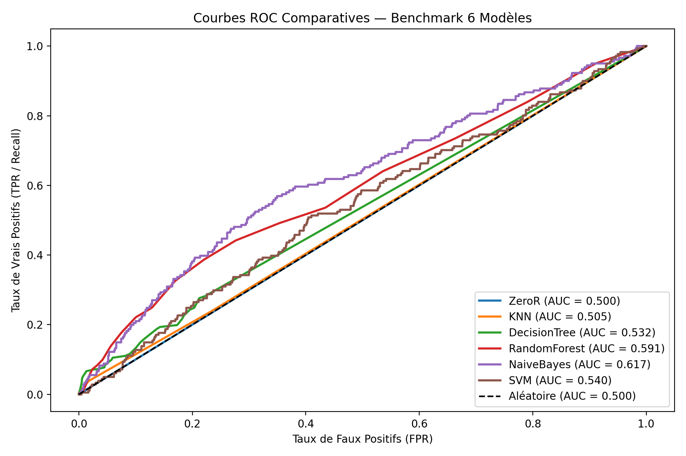
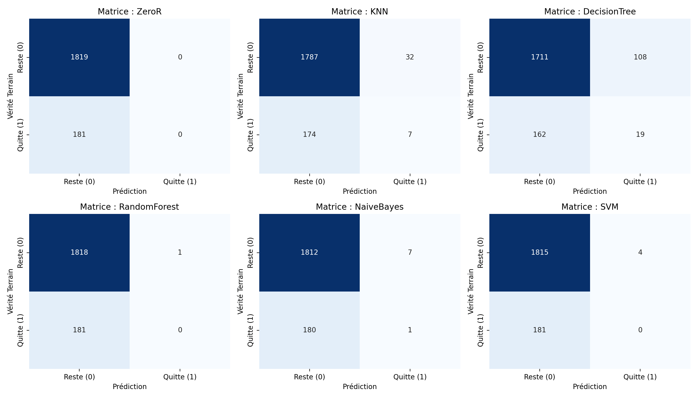
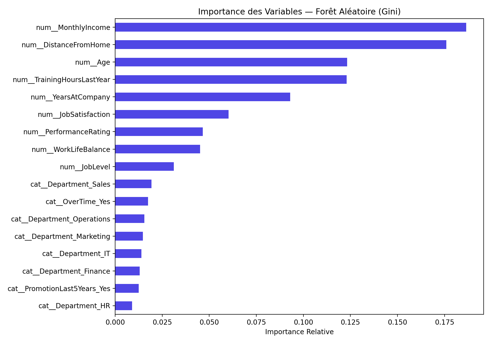

#  Employee Attrition Prediction Using Data Mining

> **Data Mining Mini-Project 2026/2027 — Track A: Supervised Classification**
> 🌐 **Live Web Application:** `<STREAMLIT_APP_URL>` · 
>📄 **Report:** [`docs/Rapport_MiniProject.pdf`](docs/Rapport_MiniProject.pdf)

---

> ⚠️ **DISCLAIMER**
> This project is developed for academic and educational purposes only. The dataset is a *synthetic simulation*; predictions must not be used for real HR decisions.

---

## 📌 Project Overview & Problem Statement

Employee turnover is costly: recruitment, onboarding, lost knowledge and lower team morale. Identifying employees at risk of leaving early lets HR teams act before it happens.

**Core Research Question:** *"Can demographic, job-related and work-environment factors (income, work-life balance, overtime, tenure, job satisfaction, etc.) accurately predict whether an employee will stay or leave the company?"*

This repository implements an end-to-end Data Mining pipeline:

1. Data acquisition and quality audit (raw ≥ 10,000 records, ≥ 10 attributes).
2. Preprocessing: missing values, outliers, encoding, scaling (leakage-free, via scikit-learn `Pipeline` / `ColumnTransformer`).
3. Exploratory Data Analysis (EDA) and statistical hypothesis testing (χ², Mann-Whitney U, Spearman, …).
4. Supervised classification benchmark: **Zero-R, K-NN, Decision Tree / Random Forest, Naïve Bayes, SVM**.
5. Hyperparameter optimisation with `GridSearchCV` / `RandomizedSearchCV` (Stratified K-Fold, K ≥ 5).
6. Interactive **Streamlit** web app with a selectable light/dark theme (EDA dashboard + real-time prediction).
7. Scientific report (PDF) in `docs/`.

> 🤖 **ML vs LLM policy:** only classical ML algorithms are used for prediction. No Deep Learning / LLM is used as a predictive model.

---

## 📊 Dataset

| Item | Value |
|---|---|
| **Name** | Employee Attrition Classification Dataset |
| **Author** | stealthtechnologies |
| **Source** | [Kaggle](https://www.kaggle.com/datasets/stealthtechnologies/employee-attrition-dataset) |
| **Files** | `train.csv`, `test.csv` |
| **Task** | Binary classification |
| **Target** | `Attrition` (`Stayed` / `Left`) |
| **Records** | `<N_TRAIN>` train / `<N_TEST>` test |
| **Attributes** | `<N_COLS>` columns (numerical + categorical) |

**Main attributes:** Age, Gender, Years at Company, Job Role, Monthly Income, Work-Life Balance, Job Satisfaction, Performance Rating, Number of Promotions, Overtime, Distance from Home, Education Level, Marital Status, Number of Dependents, Job Level, Company Size, Company Tenure, Remote Work, Leadership Opportunities, Innovation Opportunities, Company Reputation, Employee Recognition.

### Dataset audit summary

| Check | Result |
|---|---|
| Total records | `<TODO>` |
| Missing values | `<TODO>` |
| Duplicates | `<TODO>` |
| Target distribution | `<TODO % Stayed>` / `<TODO % Left>` |

> 💾 If the data exceeds 100 MB, host it externally and use `scripts/download_data.py` (via `kagglehub`) instead of committing it.

```python
import kagglehub
path = kagglehub.dataset_download("stealthtechnologies/employee-attrition-dataset")
print("Path to dataset files:", path)
```

---

## 🧪 Statistical Hypothesis Testing

Significance level α = 0.05, with multiple-testing correction (Benjamini-Hochberg FDR) and effect sizes.

| ID | Hypothesis | Test | Justification | p-value | Effect size | Decision |
|---|---|---|---|---|---|---|
| H1 | Overtime ⟂ Attrition | Chi-square | Two categorical variables | `<TODO>` | Cramér's V = `<TODO>` | `<TODO>` |
| H2 | Monthly Income differs between Stayed / Left | Mann-Whitney U | Non-normal numeric (Shapiro-Wilk) vs binary group | `<TODO>` | `<TODO>` | `<TODO>` |
| H3 | Work-Life Balance ⟂ Attrition | Chi-square | Ordinal/categorical vs categorical | `<TODO>` | `<TODO>` | `<TODO>` |
| H4 | Age vs Years at Company | Spearman | Monotonic, non-normal | `<TODO>` | ρ = `<TODO>` | `<TODO>` |

> Replace with the tests you actually ran (minimum required: 2, each with a justification of why the test is appropriate).

---

## 🏆 Model Performance Benchmark

All models were tuned with `GridSearchCV` / `RandomizedSearchCV` using **Stratified 5-Fold Cross-Validation** and evaluated on a hold-out test set.

| Model | Accuracy | Precision | Recall | F1 | ROC-AUC | CV Score (F1) |
|---|---|---|---|---|---|---|
| Zero-R Baseline | `<TODO>` | `<TODO>` | `<TODO>` | `<TODO>` | 0.5000 | `<TODO>` |
| K-Nearest Neighbors | `<TODO>` | `<TODO>` | `<TODO>` | `<TODO>` | `<TODO>` | `<TODO>` |
| Decision Tree | `<TODO>` | `<TODO>` | `<TODO>` | `<TODO>` | `<TODO>` | `<TODO>` |
| Random Forest | `<TODO>` | `<TODO>` | `<TODO>` | `<TODO>` | `<TODO>` | `<TODO>` |
| Naïve Bayes | `<TODO>` | `<TODO>` | `<TODO>` | `<TODO>` | `<TODO>` | `<TODO>` |
| SVM | `<TODO>` | `<TODO>` | `<TODO>` | `<TODO>` | `<TODO>` | `<TODO>` |

**Best model:** `<MODEL_NAME>` — Accuracy `<X>`, ROC-AUC `<Y>`.

### Best hyperparameters

| Model | Tuned parameters |
|---|---|
| K-NN | `n_neighbors`, `metric`, `weights` |
| Decision Tree / RF | `max_depth`, `min_samples_leaf`, `ccp_alpha`, `n_estimators` |
| Naïve Bayes | `var_smoothing` / `alpha` (Laplace smoothing) |
| SVM | `kernel` (RBF / linear / poly), `C`, `gamma` |

### Figures

| ROC curves | Confusion matrices | Feature importance |
|---|---|---|
|  |  |  |

---

## 💡 Key Findings

1. `<Finding 1 — e.g. class balance and which metric you prioritised>`
2. `<Finding 2 — e.g. top drivers of attrition (overtime, work-life balance, job satisfaction…)>`
3. `<Finding 3 — e.g. best vs baseline gap>`
4. `<Finding 4 — e.g. trade-off between recall and precision for HR use>`

---

## 🌐 Interactive Streamlit Web Application

| Page | Content |
|---|---|
| **Home** | Project summary, key metrics |
| **EDA Dashboard** | Descriptive stats, missing data, numeric distributions, categorical frequencies, correlation matrix, ≥ 1 interactive filter |
| **Model Benchmark** | Comparison table, ROC curves, confusion matrices |
| **Attrition Predictor** | Input form → real-time Stay / Leave prediction with probability |
| **About** | Team roles, tech stack |

```bash
streamlit run src/app.py
```

---

## 📁 Repository Structure

```
.
├── README.md
├── LICENSE
├── .gitignore
├── requirements.txt
├── data/
│   ├── raw/                 # train.csv, test.csv (or download script)
│   └── processed/
├── notebooks/
│   ├── 01_eda_and_cleaning.ipynb
│   ├── 02_statistical_analysis.ipynb
│   ├── 03_preprocessing.ipynb
│   └── 04_model_training_evaluation.ipynb
├── src/
│   ├── app.py               # Streamlit application
│   ├── preprocessing.py
│   ├── models.py
│   ├── evaluation.py
│   └── utils.py
├── models/                  # saved pipeline + best model (.joblib)
├── results/                 # metrics, test results (json/csv)
├── scripts/                 # download / training scripts
└── docs/
    ├── Rapport_MiniProject.pdf
    └── figures/
```

---

## ⚙️ Installation & Reproducibility

**Prerequisites:** Python 3.10+ and `pip`.

```bash
# 1. Clone the repository
git clone https://github.com/<USERNAME>/<REPO_NAME>.git
cd <REPO_NAME>

# 2. (Recommended) create a virtual environment
python -m venv venv
source venv/bin/activate        # Windows: venv\Scripts\activate

# 3. Install dependencies
pip install -r requirements.txt

# 4. Download the dataset (needs a Kaggle account / API token)
python scripts/download_data.py

# 5. Run the training pipeline
python scripts/train_pipeline.py

# 6. Launch the web app
streamlit run src/app.py
```

---

## 👥 Team & Contributions
<!-- 
| Student | Student code | GitHub | Role & responsibilities |
|---|---|---|---|
| `<Full name>` (Leader) | `<CODE>` | [@username1](https://github.com/username1) | Preprocessing, project coordination |
| `<Full name>` | `<CODE>` | [@username2](https://github.com/username2) | EDA & statistical tests |
| `<Full name>` | `<CODE>` | [@username3](https://github.com/username3) | Modeling & optimisation |
| `<Full name>` | `<CODE>` | [@username4](https://github.com/username4) | Streamlit app |
| `<Full name>` | `<CODE>` | [@username5](https://github.com/username5) | Report & documentation |

> Each member contributes through their **own GitHub account** with regular, individual commits. -->

---

## 📜 References

- stealthtechnologies, *Employee Attrition Classification Dataset*, Kaggle.
- Pedregosa et al., *Scikit-learn: Machine Learning in Python*, JMLR 12:2825-2830, 2011.
- Course material — Data Mining 2026/2027.

<!-- ## 📄 License

Released under the MIT License — see [`LICENSE`](LICENSE). -->

---

## Application web (Streamlit)

- **Statut :** ✅ Opérationnelle
- **Commande de lancement :**
  ```bash
  streamlit run app/Home.py
  ```

### Design System

L'application utilise un **thème indigo professionnel** (`#4F46E5`) avec :

- `.streamlit/config.toml` — thème Streamlit (couleur primaire, fond clair, texte sombre)
- `app/style.css` — styles personnalisés : cartes KPI, badges de risque (vert/orange/rouge), sidebar branded
- `app/utils.py` — composants réutilisables : `kpi_card()`, `risk_badge()`, `section_header()`, `gauge_chart()`
- Graphiques **Plotly** avec palette cohérente (template `plotly_white`)

### Arborescence

```text
app/
├── Home.py                    # Page d'accueil avec KPI globaux et navigation
├── utils.py                   # Composants UI, chargement données/modèles
├── style.css                  # Feuille de styles CSS personnalisée
└── pages/
    ├── 1_Dashboard.py         # 📊 Dashboard analytique interactif
    ├── 2_Prediction.py        # 🔮 Prédiction individuelle + What-If + SHAP
    ├── 3_Performance_Modeles.py # 🏆 Benchmark 6 modèles
    ├── 4_Facteurs_Demission.py  # 🔍 Feature importance + SHAP global
    ├── 5_Prediction_en_lot.py   # 📦 Prédiction CSV en lot
    └── 6_A_Propos.py            # 📖 Documentation & éthique
```

### Pages disponibles

| Page | Description / Fonctionnalités |
|---|---|
| **1. Dashboard** | KPI, distributions, corrélations, filtres globaux (département, âge, revenus, overtime) |
| **2. Prédiction individuelle** | Formulaire interactif, jauge de risque, recommandations RH ciblées, simulation What-If, explications SHAP locales |
| **3. Performance des modèles** | Métriques (Accuracy, F1, ROC-AUC, MCC), matrices de confusion, courbes ROC comparatives |
| **4. Facteurs de démission** | Feature importance (Random Forest), SHAP global (beeswarm), top 5 facteurs de départ |
| **5. Prédiction en lot** | Upload CSV multi-employés, tableau trié par risque, export Excel/CSV |
| **6. À Propos** | Pipeline Data Mining, dictionnaire des données, mentions éthiques |

---

## 📓 Notebooks Jupyter

L'analyse exploratoire (EDA), le nettoyage des données et les tests d'hypothèses statistiques sont menés dans les notebooks dédiés :

| Notebook | Description / Contenu |
|---|---|
| [`01_eda_and_cleaning.ipynb`](notebooks/01_eda_and_cleaning.ipynb) | **EDA & Nettoyage :** audit qualité (NaN, doublons, constantes), détection et écrêtage des outliers (IQR × 1.5), pipeline de nettoyage avec comparaison avant/après, analyse univariée (distributions & formes), bivariée (boxplots, barres empilées), heatmap de corrélations, analyse du déséquilibre de classes et export |
| [`02_statistical_analysis.ipynb`](notebooks/02_statistical_analysis.ipynb) | **Tests d'hypothèses statistiques :** H1 (OverTime ⟂ Attrition, χ²), H2 (MonthlyIncome × Attrition, Mann-Whitney U), H3 (WorkLifeBalance ⟂ Attrition, χ²), H4 (Age vs YearsAtCompany, Spearman), correction Benjamini-Hochberg FDR, tailles d'effet (Cramér's V, Cohen's d), ANOVA |

### Technologies

- Streamlit
- Plotly
- scikit-learn
- SHAP
- pandas / numpy
- scipy / statsmodels
- joblib
