# Rapport scientifique — Prédiction de l'attrition des employés
Mini-projet de Data Mining — PROJ-IASD06 — année universitaire 2026/2027
Version lot 5 : intégration des résultats des lots 0 à 4
Jeu synthétique de 10 000 dossiers — 12 variables explicatives
Périmètre : données, modèles, évaluation et explicabilité ; interface hors périmètre
26 novembre 2026

## 1. Résumé exécutif

Ce rapport documente l'intégralité de la chaîne de fouille de données réalisée sur le jeu synthétique *Employee Attrition* : audit et exploration, contrôles statistiques, prétraitement sans fuite, détection des outliers, modélisation supervisée, apprentissage non supervisé et explicabilité locale. Le jeu comporte 10 000 lignes et 14 colonnes brutes ; après exclusion de l'identifiant `EmployeeID` et de la cible `Attrition`, 12 variables explicatives sont conservées. La classe positive `Yes` représente 903 employés, soit 9,03 % de l'échantillon. Aucune valeur manquante ni aucun doublon n'a été détecté.

Deux protocoles supervisés distincts sont rapportés, car ils répondent à des critères de sélection différents et ne doivent pas être confondus. Le **pipeline du guide** sélectionne sur le F1 moyen en validation croisée stratifiée à cinq plis parmi six modèles imposés ; il retient `DecisionTree` avec un F1 de validation croisée de 0,1365 ± 0,0230 et un F1 sur le jeu de test de 0,1230 (ROC-AUC = 0,5406). L'**analyse étendue** sélectionne sur la précision moyenne (*Average Precision*, AP) parmi 14 configurations définies (9 variantes évaluées) ; elle retient `Gradient Boosting` avec une AP de validation croisée de 0,1729 ± 0,0136. Au seuil optimisé de 0,1176, ce dernier obtient sur le test une exactitude de 0,7605, une précision de 0,1761, un rappel de 0,4475, un F1 de 0,2527, une ROC-AUC de 0,6648 (IC 95 % bootstrap : [0,622 ; 0,705]) et une PR-AUC de 0,1732.

- Au seuil par défaut de 0,5, **tous** les modèles étendus prédisent zéro départ : leur F1 est nul. L'optimisation du seuil de décision, calibrée hors du jeu de test, est donc indispensable avec une classe rare à 9 %.
- La référence `Zero-R` atteint 0,9095 d'exactitude mais un F1 nul : elle illustre le piège de l'exactitude sur un jeu déséquilibré et justifie le choix de l'AP et du F1.
- Quatre méthodes de détection des outliers et sept approches non supervisées ont été comparées ; l'explicabilité locale est centralisée dans un module SHAP réutilisable.

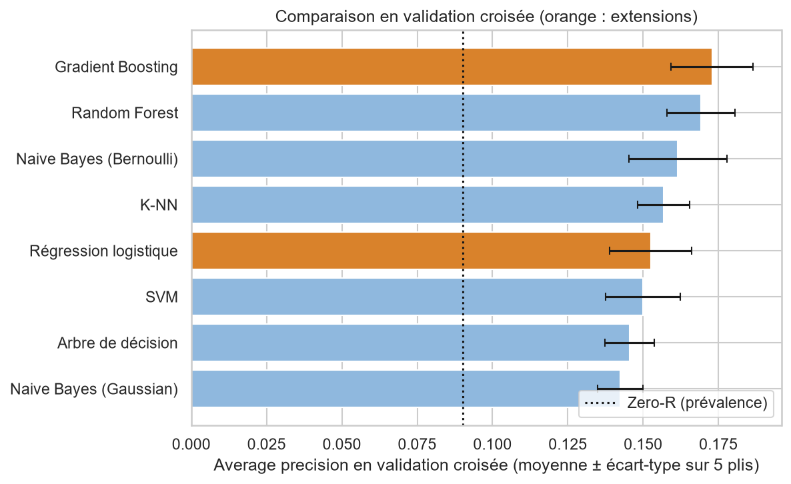

**Conclusion.** Le signal prédictif de ce jeu synthétique reste limité : même le meilleur modèle ne dépasse pas 0,1732 de PR-AUC, contre 0,0905 pour la référence. Les résultats sont néanmoins reproductibles, statistiquement étayés et honnêtement bornés par des intervalles de confiance.

## 2. Problématique et démarche

### 2.1 Question de recherche

Comment anticiper le départ volontaire d'un employé à partir de variables professionnelles et organisationnelles, tout en conservant un modèle interprétable et un protocole exempt de fuite de données ? Deux hypothèses opérationnelles ont été testées : (H1) la satisfaction au travail et l'équilibre vie professionnelle/vie privée sont plus faibles chez les partants ; (H2) les heures supplémentaires sont associées à une augmentation du risque de départ.

### 2.2 Démarche CRISP-DM

| Étape | Contenu du projet | Livrables |
|---|---|---|
| Compréhension du métier | Objectif de détection précoce, coût d'une alerte, contrainte d'anonymat | `docs/PLAN_PROJET.md` |
| Compréhension des données | Audit, statistiques descriptives, tests, corrélations | `notebooks/01_eda_and_cleaning.ipynb`, figures 01 à 08 |
| Préparation | Encodage, imputation, écrêtage, standardisation, split stratifié | `src/preprocessing.py`, `scripts/run_preprocessing.py` |
| Modélisation | 6 modèles du guide, 8 extensions, recherche d'hyperparamètres | `src/models.py`, `scripts/train_pipeline.py`, `scripts/train_models.py` |
| Évaluation | CV stratifiée, seuil, bootstrap, calibration, matrices de confusion | `results/*.csv`, figures 17 à 35 |
| Déploiement | Inférence et explicabilité mutualisées ; interface séparée | `src/explainability.py`, `scripts/run_explainability.py` |

Le cycle est itératif : les résultats d'évaluation ont conduit à ajuster le prétraitement (écrêtage IQR plus conservateur dans le pipeline) puis à ajouter des modèles d'ensemble et un mécanisme de sélection de variables.

### 2.3 Contraintes et périmètre

- **Anonymat strict** : seuls des codes employés sont manipulés ; aucun nom, e-mail ou information personnelle n'est enregistré.
- **Contrat de données figé** : `No -> 0` et `Yes -> 1`, 12 features, `EmployeeID` et `Attrition` exclus de `X`, probabilité de la classe `Yes` renvoyée par `predict_proba`.
- **Noms imposés** : `ZeroR`, `KNN`, `DecisionTree`, `RandomForest`, `NaiveBayes`, `SVM` sont conservés tels quels dans le pipeline du guide.
- **Interface exclue** : `app/**`, `.streamlit/**` et `src/app.py` appartiennent à un autre membre et ne sont pas modifiés par ces lots.

## 3. Données et exploration

### 3.1 Schéma

Le CSV brut contient 10 000 lignes et 14 colonnes. Le schéma est validé avant tout traitement. Les 12 variables conservées se répartissent en cinq variables numériques, quatre échelles ordinales à cinq niveaux, deux variables binaires et une variable nominale.

| Type | Variables | Traitement |
|---|---|---|
| Numériques | Age, YearsAtCompany, MonthlyIncome, DistanceFromHome, TrainingHoursLastYear | imputation médiane, écrêtage IQR, standardisation |
| Ordinales | JobLevel, JobSatisfaction, WorkLifeBalance, PerformanceRating | imputation médiane, standardisation, ordre conservé |
| Binaires | OverTime, PromotionLast5Years | encodage `No -> 0`, `Yes -> 1` |
| Nominale | Department | one-hot encoding sans ordre arbitraire |

Après exclusion de l'identifiant et de la cible, `Age` a une moyenne de 37,69 ans (écart-type 9,38), `MonthlyIncome` de 8 967,92 (écart-type 3 500,75) et `YearsAtCompany` de 7,79 ans. `DistanceFromHome` est fortement asymétrique (asymétrie 1,35, maximum 50) et justifie l'écrêtage. Les modalités de `Department` et les taux de départ associés sont visualisés en figure 05.

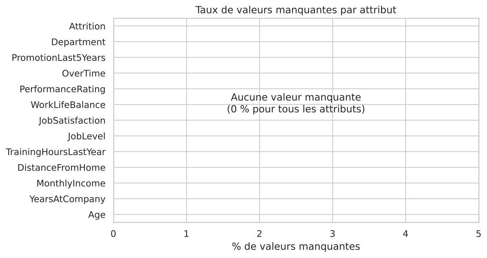

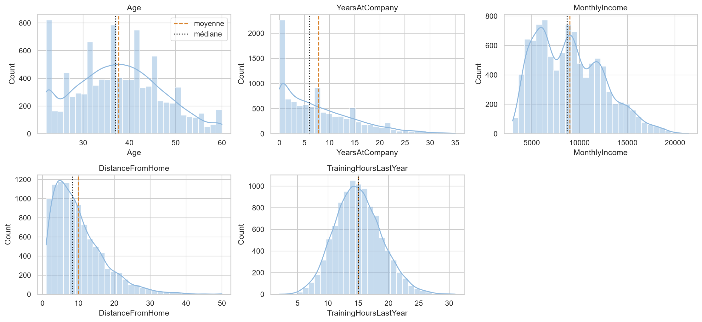

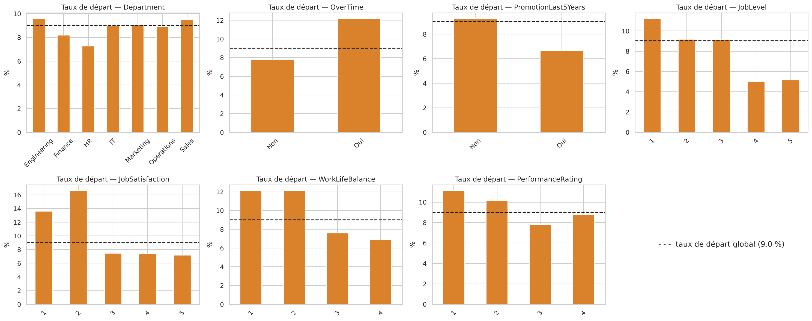

### 3.2 Signaux statistiques

Les tests non paramétriques de Mann-Whitney et les tests du chi-deux ont été appliqués à chaque variable contre la cible, avec correction de Benjamini-Hochberg des p-valeurs et calcul d'une taille d'effet.

| Variable | Test | p ajustée (BH) | Effet | Sens |
|---|---|---:|---:|---|
| JobSatisfaction | Mann-Whitney | 3,19 e-16 | 0,1637 | plus faible chez les partants |
| WorkLifeBalance | Mann-Whitney | 1,08 e-12 | 0,1398 | plus faible chez les partants |
| JobLevel | Mann-Whitney | 7,97 e-10 | 0,1231 | plus faible chez les partants |
| YearsAtCompany | Mann-Whitney | 4,00 e-09 | 0,1211 | plus faible chez les partants |
| OverTime | Khi-deux | 2,11 e-11 | 0,0690 | association faible |

Les hypothèses H1 et H2 sont confirmées au sens statistique, mais les tailles d'effet classées « faibles » ou « négligeables » expliquent la modestité des performances prédictives. `Department` (p ajustée = 0,583), `TrainingHoursLastYear` (0,573) et `DistanceFromHome` (0,906) ne sont pas significatifs après correction.

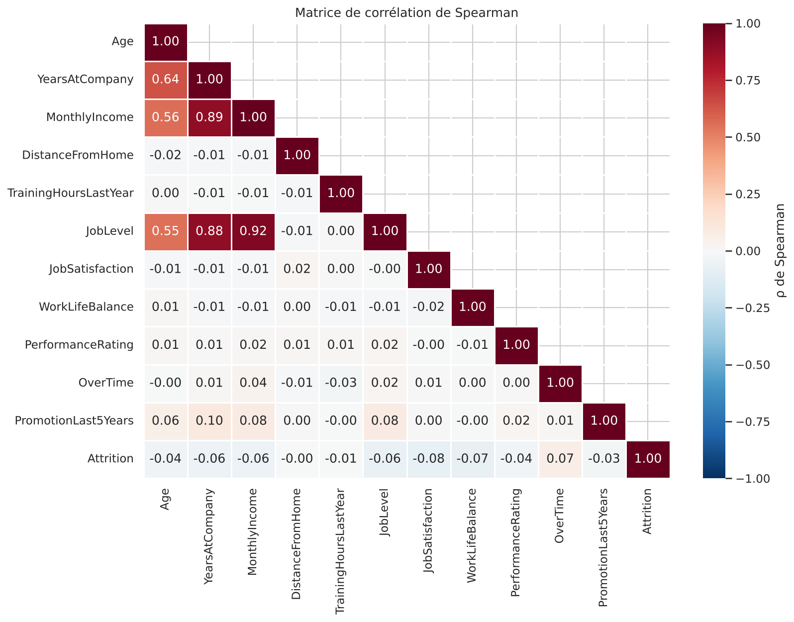

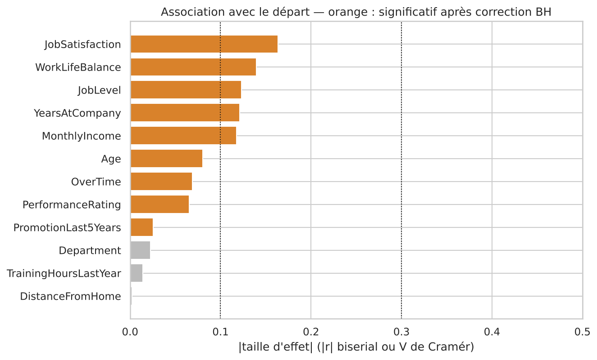

## 4. Prétraitement et prévention des fuites

Le nettoyage initial (`clean_data`) est déterministe : normalisation des textes, contrôle du schéma, suppression des doublons éventuels, mise à `NaN` des valeurs hors plages plausibles et encodage `No -> 0` / `Yes -> 1` de la cible. Il n'apprend aucune statistique et peut donc être appliqué avant la séparation des jeux.

Les transformations avec apprentissage sont regroupées dans un unique `ColumnTransformer` inséré dans chaque Pipeline scikit-learn : imputation par la médiane, écrêtage IQR des variables numériques avec un facteur Conservateur de 3,0, standardisation Z-score et one-hot encoding. Ce transformateur est ajusté uniquement sur le jeu d'entraînement à l'intérieur de chaque pli de validation croisée. La sélection de variables ajoutée au lot 4 (`SelectKBest`) est également **dans** le Pipeline, donc re-ajustée à chaque pli : aucun test ni pli de validation ne participe au réglage du préprocesseur.

La séparation est stratifiée (80 % entraînement, 20 % test, graine 42) et la classe positive est explicitement l'indice 1 de `predict_proba`. Le jeu de test sert exclusivement à l'évaluation finale ; le seuil de décision est optimisé sur les données d'entraînement/validation.

## 5. Détection des outliers

Quatre méthodes complémentaires ont été appliquées aux variables numériques et ordinales, sans utiliser la cible : Z-score, intervalle interquartile (IQR), Isolation Forest et *Local Outlier Factor* (LOF). Les approches multivariées utilisent neuf variables et une contamination fixée à 5 %.

| Méthode | Variable | Nombre | Pourcentage | Seuil |
|---|---|---:|---:|---|
| Z-score | DistanceFromHome | 137 | 1,37 % | `|z| > 3` |
| IQR | DistanceFromHome | 306 | 3,06 % | IQR x 1,5 |
| IQR | JobSatisfaction | 500 | 5,00 % | IQR x 1,5 |
| Isolation Forest | multivarié (9 variables) | 500 | 5,00 % | contamination = 0,05 |
| LOF | multivarié (9 variables) | 500 | 5,00 % | n_voisins = 20 |

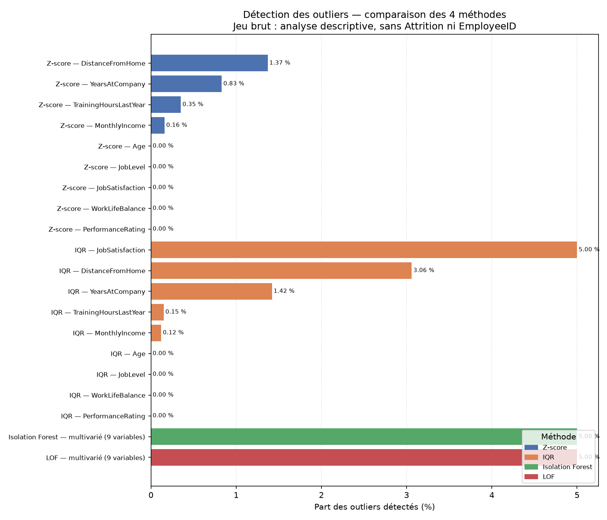

**Règle interprétative.** Un outlier n'est pas une erreur : sur un jeu synthétique, une valeur extrême peut correspondre à un profil métier réel. La suppression n'est autorisée que si une erreur de saisie est avérée ; sinon, la stratégie retenue est l'investigation puis l'écrêtage (winsorisation) appliqué à l'intérieur du Pipeline. L'écrêtage par défaut utilise un facteur IQR de 3,0, plus conservateur que le seuil d'analyse de 1,5.

## 6. Modélisation supervisée

### 6.1 Deux protocoles de sélection

Le pipeline du guide (`scripts/train_pipeline.py`) évalue six modèles imposés avec `StratifiedKFold(n_splits=5, shuffle=True, random_state=42)` et retient le F1 moyen maximal en validation croisée. L'analyse étendue (`scripts/train_models.py`, `src/models.py`) définit 14 configurations et évalue 9 variantes avec le même découpage, mais sélectionne sur l'AP, plus adaptée à une classe rare, et suit ROC-AUC et F1 en parallèle.

Les 14 configurations documentées sont : `Zero-R`, K-NN, arbre de décision, forêt aléatoire, Naive Bayes gaussien, Naive Bayes de Bernoulli, SVM, régression logistique, Gradient Boosting, Extra Trees, AdaBoost, Bagging, K-NN en métrique cosinus et régression logistique avec `SelectKBest` intégré au Pipeline. Seules 9 variantes figurent dans les CSV de résultats versionnés. `XGBoost` est déclaré comme dépendance optionnelle mais absent de l'environnement de référence ; le code désactive proprement cette extension et elle n'est donc pas rapportée. Aucun réseau de neurones ni LLM n'est utilisé comme modèle prédictif.

### 6.2 Réglage, seuil et incertitude

Chaque modèle est réglé par `GridSearchCV` ou `RandomizedSearchCV` avec validation croisée stratifiée à cinq plis. Le seuil de décision est choisi sur les prévisions de validation pour maximiser le F1, puis figé avant l'évaluation sur le jeu de test. Des intervalles de confiance bootstrap (échantillonnage répété du jeu de test) bornent les métriques ; la calibration et le gain/lift sont également contrôlés.

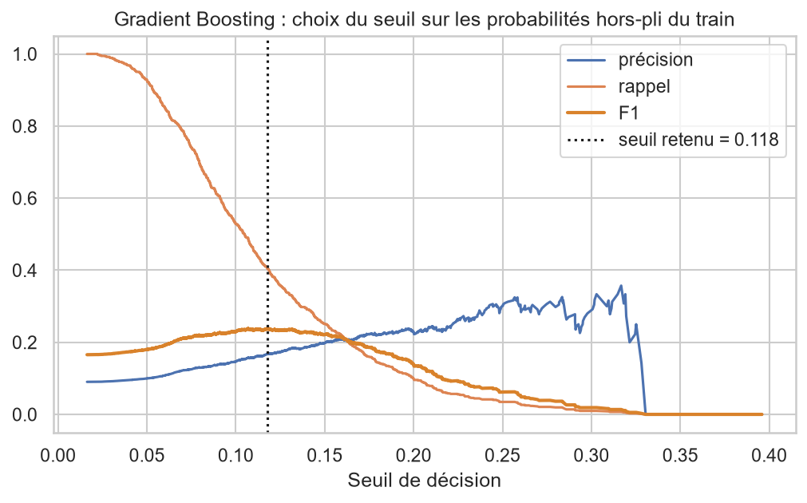

## 7. Résultats supervisés

### 7.1 Pipeline du guide — six modèles imposés

| Modèle | F1 CV | Accuracy test | Precision | Recall | F1 test | ROC-AUC |
|---|---:|---:|---:|---:|---:|---:|
| ZeroR | 0,0000 | 0,9095 | 0,0000 | 0,0000 | 0,0000 | 0,5000 |
| KNN | 0,0542 | 0,8930 | 0,1633 | 0,0442 | 0,0696 | 0,5424 |
| DecisionTree | 0,1365 | 0,8645 | 0,1484 | 0,1050 | 0,1230 | 0,5406 |
| RandomForest | 0,0055 | 0,9090 | 0,0000 | 0,0000 | 0,0000 | 0,5921 |
| NaiveBayes | 0,0833 | 0,8915 | 0,2000 | 0,0663 | 0,0996 | 0,6206 |
| SVM | 0,0027 | 0,9085 | 0,0000 | 0,0000 | 0,0000 | 0,5404 |

`DecisionTree` est retenu par ce protocole avec F1 CV = 0,1365 ± 0,0230, F1 test = 0,1230 et ROC-AUC = 0,5406. L'écart avec `ZeroR` reste faible : ce résultat doit être lu comme une preuve de faisabilité, pas comme une performance opérationnelle.

### 7.2 Analyse étendue — 14 configurations définies et seuil optimisé

| Modèle | AP CV | ROC-AUC test | PR-AUC test | Seuil | F1 au seuil |
|---|---:|---:|---:|---:|---:|
| Zero-R | — | 0,5000 | 0,0905 | 0,500 | 0,0000 |
| K-NN | 0,1568 | 0,6511 | 0,1691 | 0,134 | 0,2365 |
| Arbre de décision | 0,1456 | 0,6083 | 0,1369 | 0,121 | 0,1972 |
| Random Forest | 0,1691 | 0,6550 | 0,1630 | 0,111 | 0,2351 |
| Naive Bayes (Gaussian) | 0,1424 | 0,6254 | 0,1435 | 0,096 | 0,2056 |
| Naive Bayes (Bernoulli) | 0,1615 | 0,6341 | 0,1520 | 0,105 | 0,2194 |
| SVM | 0,1499 | 0,6554 | 0,1576 | 0,110 | 0,2391 |
| Régression logistique | 0,1525 | 0,6564 | 0,1595 | 0,116 | 0,2392 |
| Gradient Boosting | 0,1729 | 0,6648 | 0,1732 | 0,118 | 0,2527 |

`Gradient Boosting` est retenu par l'analyse étendue. Au seuil optimisé de 0,1176, ses métriques test sont : exactitude 0,7605, précision 0,1761, rappel 0,4475, F1 0,2527, ROC-AUC 0,6648 (IC 95 % bootstrap [0,622 ; 0,705]), PR-AUC 0,1732, MCC 0,1630 et Brier 0,0796. L'intervalle bootstrap de la ROC-AUC ne recoupe pas la valeur 0,5 de la référence, ce qui confirme un signal discriminatif réel mais modeste.

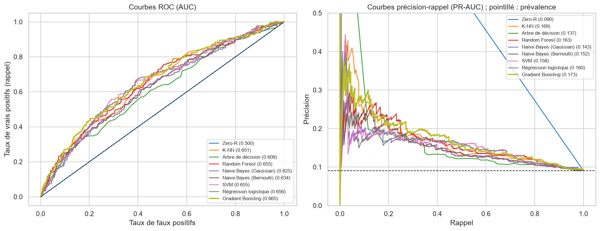

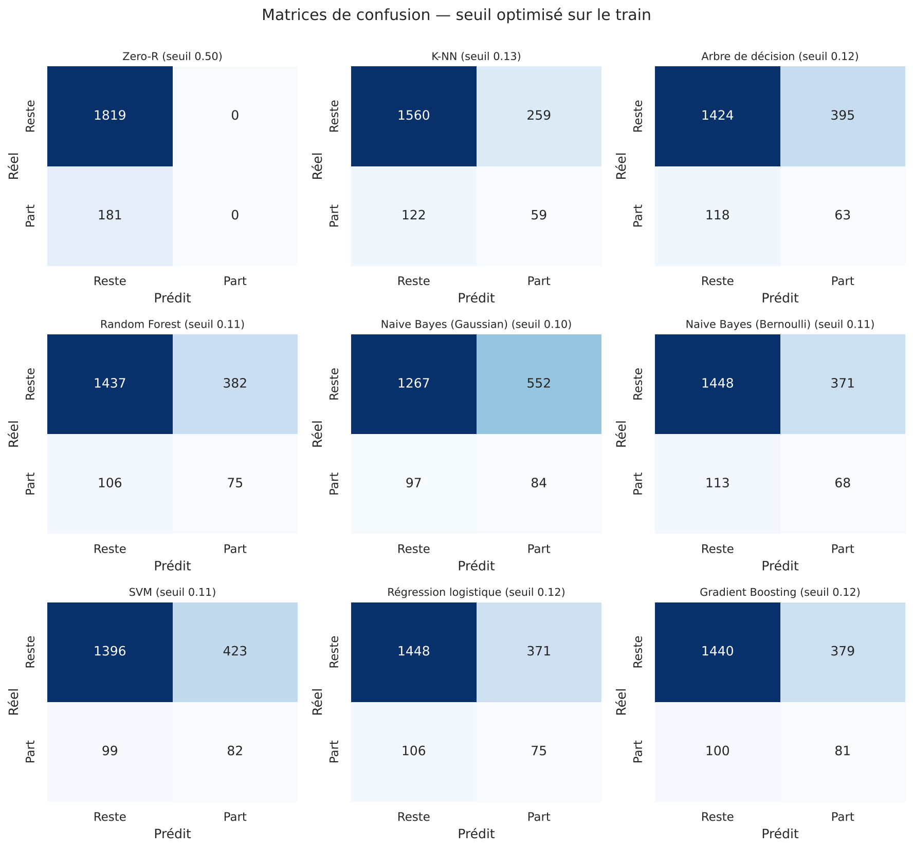

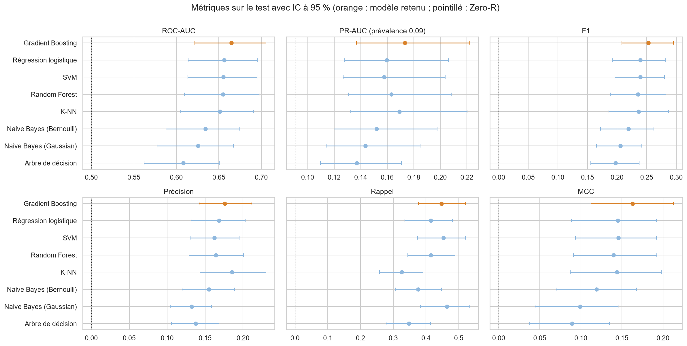

Les deux protocoles ne sont pas hiérarchisés : ils optimisent des critères différents et leurs résultats sont conservés séparément dans les CSV versionnés. Le lot 4 ajoute cinq configurations sans modifier les clés historiques du guide ; les modèles d'ensemble étendus sont évalués avec le même contrat de probabilité de la classe `Yes`.

## 8. Interprétation et explicabilité

### 8.1 Importances globales

Les importances par permutation montrent que `JobSatisfaction`, `WorkLifeBalance`, `JobLevel` et `MonthlyIncome` contribuent le plus à la réduction de l'erreur. Ce classement est cohérent avec les tests statistiques du paragraphe 3.2, sans pour autant établir de lien de causalité.

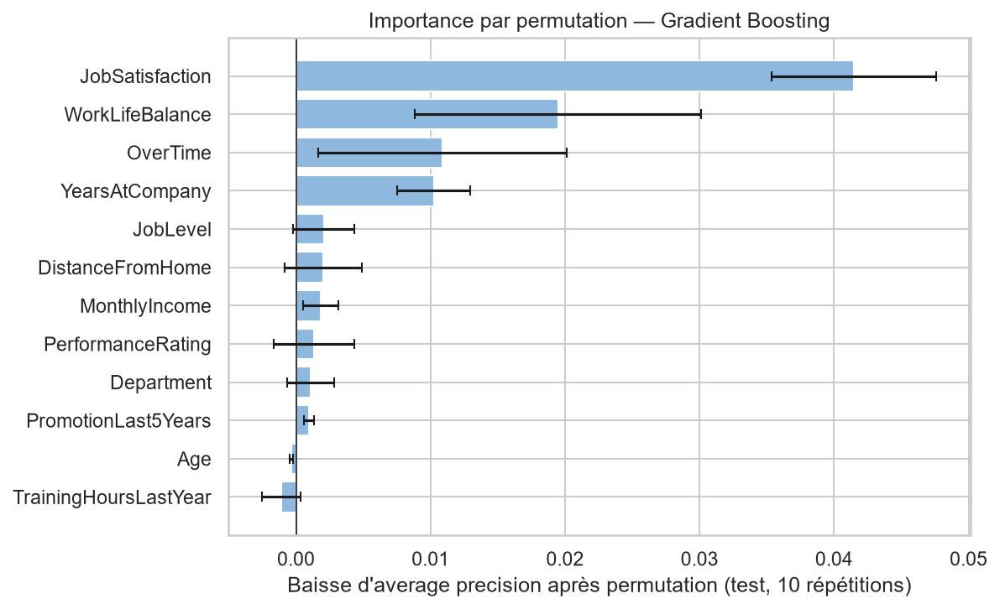

### 8.2 Explications locales SHAP

Le module `src/explainability.py` centralise l'explication des prédictions individuelles. Il recombine les colonnes one-hot vers les 12 variables métier et refuse explicitement `EmployeeID` et `Attrition` en entrée. Les modèles à base d'arbres utilisent `TreeExplainer` sans échantillon de fond ; les autres modèles utilisent un fond de 100 lignes. `python scripts/run_explainability.py` régénère les 600 explications du fichier `results/explainability_top3.csv` et la figure 42 sur 200 employés du jeu de test.

Pour le premier employé échantillonné, la probabilité de départ est de 0,3668. Les trois facteurs dominants sont `WorkLifeBalance` (-0,0616), `JobSatisfaction` (-0,0523) et `OverTime` (-0,0441), tous trois en faveur d'une réduction du risque. Sur un autre employé (probabilité 0,5758), `JobSatisfaction` devient le premier facteur avec une contribution positive de +0,1499.

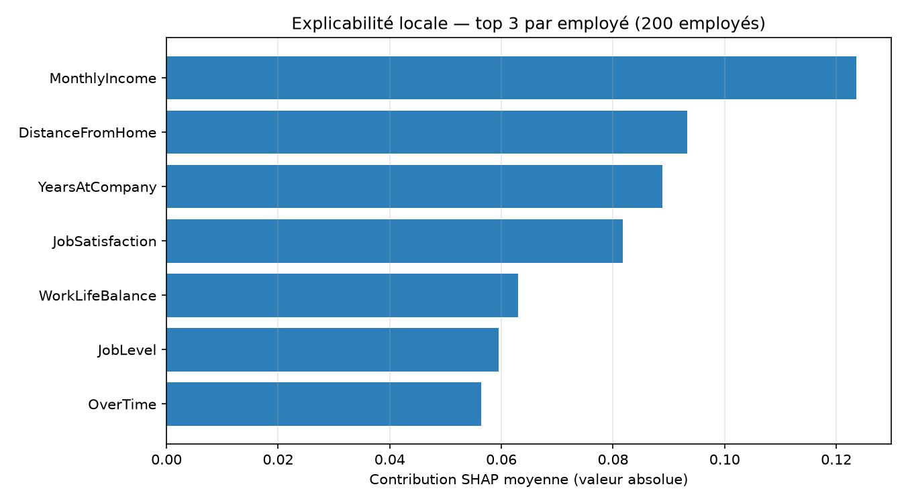

SHAP est une aide à l'interprétation des prédictions du modèle, pas un modèle prédictif et pas une preuve causale. Le signe d'une contribution indique seulement son effet sur la sortie du modèle entraîné.

## 9. Apprentissage non supervisé

### 9.1 Choix du nombre de groupes

Le balayage de k de 2 à 10 pour K-Means montre que la silhouette maximale est obtenue pour k = 2 (0,1875), mais l'interprétabilité métier et la stabilité des tailles de groupes conduisent à retenir **k = 3** (silhouette 0,1083, indice de Davies-Bouldin 2,4840). Le coude de l'inertie et la silhouette sont reportés en figure 37.

| Méthode | k | Silhouette | Davies-Bouldin | Bruit | Commentaire |
|---|---:|---:|---:|---:|---|
| K-Means | 3 | 0,1083 | 2,4840 | 0 | partition retenue |
| Agglomératif (Ward) | 3 | 0,0847 | 2,6413 | 0 | connectivité 10-PPV |
| DBSCAN | 3 | 0,1756 | 1,6513 | 1 394 | eps = 0,18, min_samples = 25 |
| K-Medoids (PAM) | 3 | 0,0890 | 2,5780 | 0 | médoïdes = points réels |
| DIANA | 3 | 0,0347 | 4,0884 | 0 | scission divisive |
| CosineKMeans | 3 | 0,1109 | 2,5109 | 0 | données normalisées L2 |
| PCA | 2 | — | — | — | projection 2D, 40,58 % de variance |

La silhouette de DBSCAN est la plus élevée mais s'accompagne de 1 394 points classés bruit, ce qui rend la partition moins exploitable pour un pilotage RH ; DIANA présente l'indice de Davies-Bouldin le plus défavorable (4,0884). L'attribut cible n'est jamais utilisé pendant l'ajustement : les taux de départ par groupe ne servent qu'à l'interprétation a posteriori.

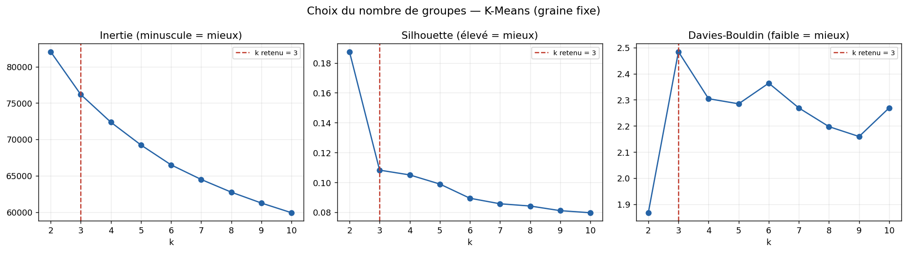

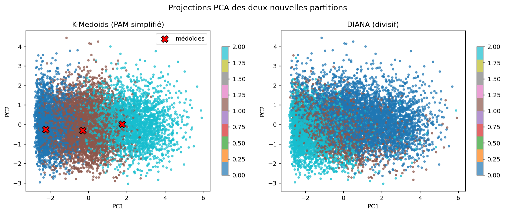

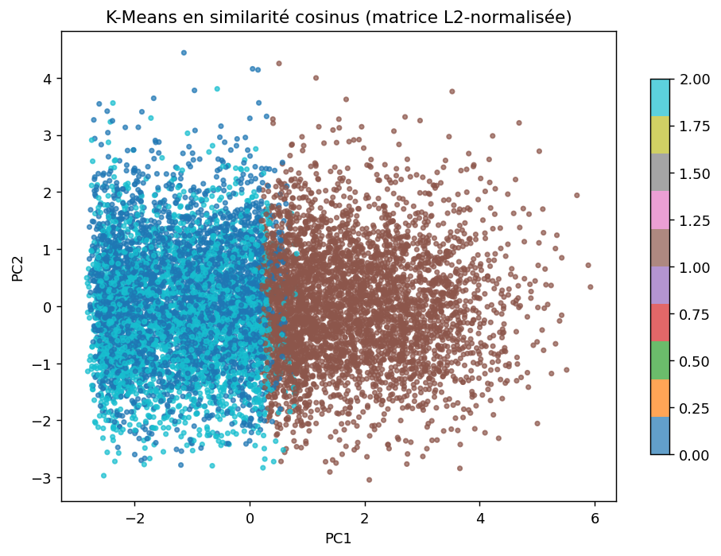

## 10. Reproductibilité et validation

| Contrôle | Commande | Résultat |
|---|---|---|
| Suite de tests | `python -m pytest tests -q` | 79 tests verts |
| Pipeline du guide | `python scripts/train_pipeline.py` | 6 modèles, artefact `best_model.joblib` (ignoré) |
| Analyse étendue | `python scripts/train_models.py` | CSV de métriques et IC bootstrap |
| Outliers | `python scripts/run_outliers.py` | `results/outliers_report.csv`, figure 36 |
| Clustering avancé | `python scripts/run_unsupervised_advanced.py` | `results/clustering_advanced.csv`, figures 37 à 41 |
| Explicabilité | `python scripts/run_explainability.py` | `results/explainability_top3.csv`, figure 42 |
| Rapport PDF | `python scripts/generate_rapport.py` | `docs/Rapport_MiniProject.pdf` et `docs/Rapport_Projet.pdf` |

Les sources CSV, les figures et ce rapport sont versionnés ; les modèles `joblib`, les JSON de métriques et les données traitées sont régénérés puis ignorés par Git. Toutes les expériences utilisent la graine 42. Les tests couvrent les modèles étendus (méthodes cosinus, ensembles, `SelectKBest` dans le Pipeline), l'explicabilité (déterminisme, refus de la cible et de l'identifiant, recombinaison des variables) et les contrats de l'interface.

## 11. Limites et perspectives

- Le jeu étant **synthétique**, les performances ne peuvent pas être transférées à une organisation réelle sans validation externe ; aucune décision RH ne doit être prise à partir de ces résultats.
- La classe positive représentant 9 % des lignes, le F1 reste sensible au seuil ; un coût par fausse alerte devrait être spécifié avant déploiement.
- Les tailles d'effet observées sont faibles et la PR-AUC plafonne à 0,1732 : la marge d'amélioration par de nouveaux modèles est probablement limitée sans nouvelles variables.
- L'interface Streamlit est livrée dans le lot 6 ; le contrat de probabilité de la classe `Yes` et les six clés historiques restent stables, et l'artefact historique `Pipeline` nu est normalisé au chargement en attendant sa régénération au format bundle.
- Les groupes non supervisés sont descriptifs : leur lecture en termes de risque est postérieure à l'ajustement et ne constitue pas une règle de décision.

## 12. Conclusion

Le projet livre une chaîne complète et vérifiable, du jeu brut au rapport PDF, avec des contrats de données explicites, une prévention des fuites par pipelines scikit-learn, une comparaison de 14 configurations supervisées définies (9 variantes évaluées) et de 7 méthodes non supervisées, ainsi qu'une explicabilité locale centralisée. Le meilleur modèle de l'analyse étendue, `Gradient Boosting`, atteint une ROC-AUC de 0,6648 et une PR-AUC de 0,1732 au seuil optimisé, contre 0,5000 et 0,0905 pour la référence `Zero-R`. Ces résultats, bornés par des intervalles de confiance et confirmés par 79 tests automatisés, constituent une base honnête pour la suite du mini-projet, en particulier l'évaluation sur un jeu externe.

## Annexe A — Traçabilité des lots

| Lot | Branche | PR | Contenu principal |
|---|---|---|---|
| 0 | `feature/lot0-organisation` | #9 | organisation, rôles, plan de projet |
| 1 | `feature/lot1-metriques-guide` | #10 | métriques et contrats cohérents |
| 2 | `feature/lot2-outliers-avances` | #11 | quatre méthodes de détection des outliers |
| 3 | `feature/lot3-clustering-avance` | #12 | choix de k, K-Medoids, DIANA, dendrogramme |
| 4 | `feature/lot4-modeles-explicabilite` | #13 | modèles étendus, SHAP, correctif du pipeline du guide |
| 5 | `feature/lot5-rapport-scientifique` | #14 (mergée) | rapport scientifique PDF et source versionnée |
| 6 | `feature/lot6-interface-streamlit` | #15 (mergée) | interface Streamlit alignée sur les contrats ML |

Chaque lot a fait l'objet d'une branche dédiée, d'un commit unique, d'une pull request distincte vers `Anwar77-b:main` et d'une demande de review à `Anwar77-b`. Les PR des lots 5 et 6 ont été mergées par le propriétaire ; les décisions de merge des autres lots lui appartiennent également.

## Annexe B — Livrables du rapport

- Source Markdown : `docs/rapport/rapport.md` ; générateur : `scripts/generate_rapport.py`.
- PDF produit : `docs/Rapport_MiniProject.pdf`, copié en `docs/Rapport_Projet.pdf` pour compatibilité.
- Figures 01 à 42 dans `reports/figures/` ; la figure `Rapport_MiniProject_apercu.pdf` est un modèle distinct conservé tel quel.
- Principaux CSV : `results/tableau_metriques_rapport.csv`, `results/cv_summary.csv`, `results/model_comparison.csv`, `results/metrics_bootstrap_ic.csv`, `results/outliers_report.csv`, `results/clustering_advanced.csv`, `results/stat_tests_vs_attrition.csv`, `results/explainability_top3.csv`.
